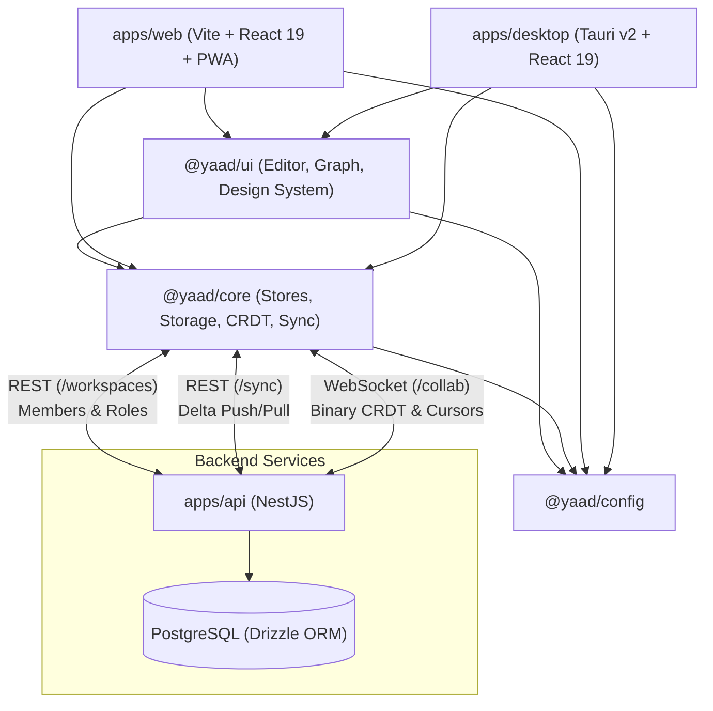
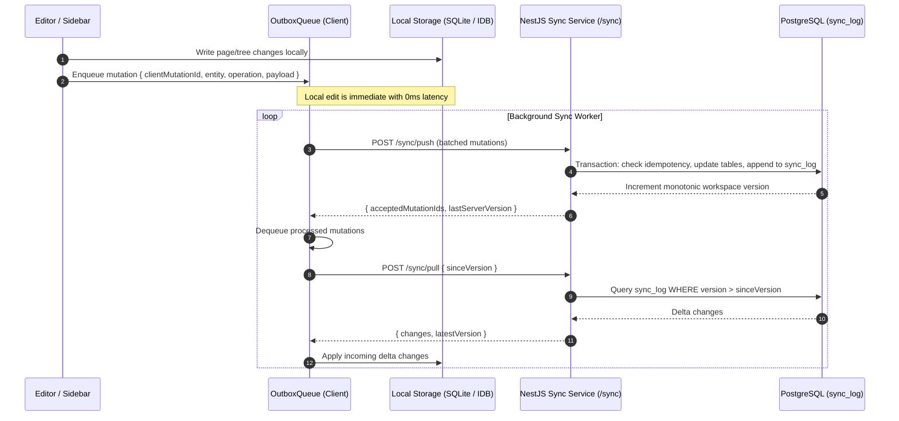
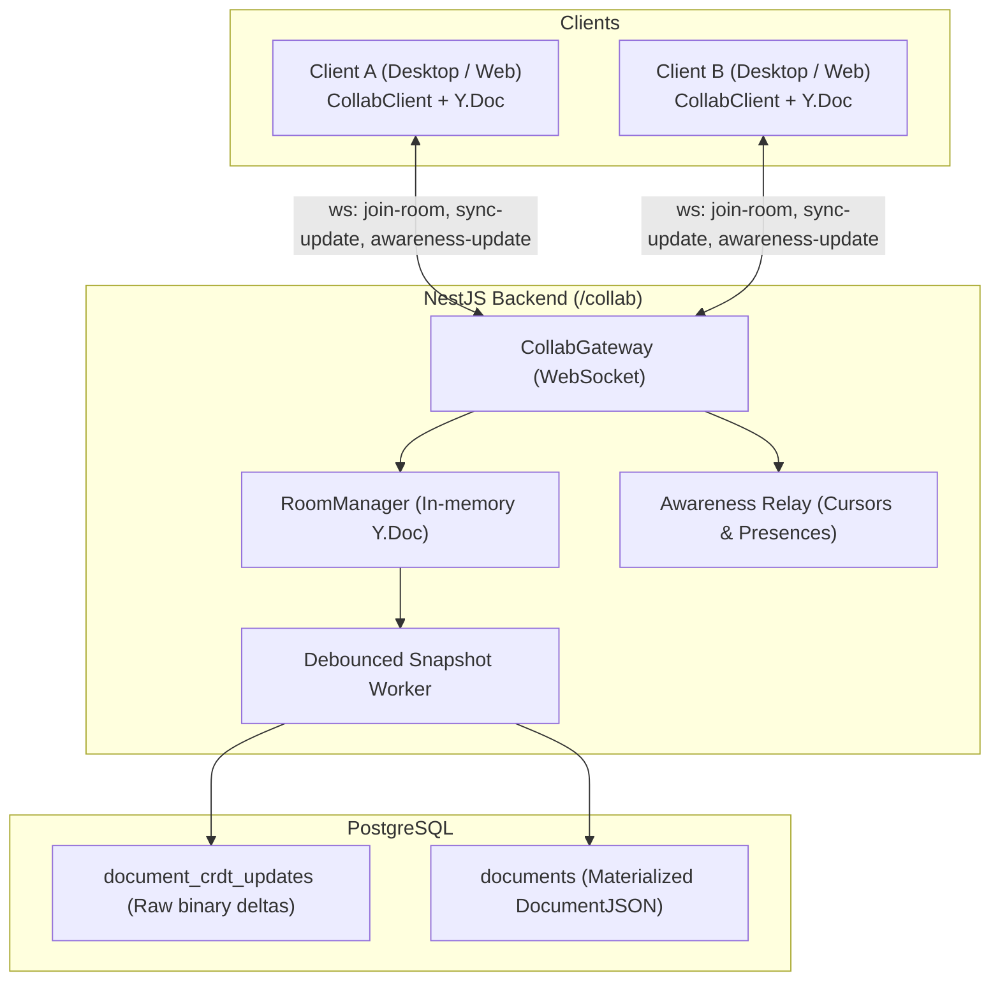

# Yaad Technical Architecture

This document describes the high-level architecture, design patterns, and subsystem implementations of Yaad.

---

## 1. System Overview

Yaad is a modular, local-first personal knowledge management (PKM) platform with real-time multiplayer collaboration structured as a pnpm monorepo:



- **Clean Layer Separation**: Pure business logic, CRDT sync algorithms, and persistence abstractions reside strictly within `@yaad/core`. No DOM, React, or browser-specific rendering elements exist in `core`.
- **Reusable Presentation Layer**: `@yaad/ui` handles rendering, rich text block editing, drag-and-drop canvas logic, graph visualization, collaboration overlays (remote cursors, presence avatars), and theme tokens.
- **Thin Shell Applications**: Both `apps/desktop` and `apps/web` act as thin application shells configuring routing and bootstrapping platform-specific capabilities (e.g. Tauri native window/SQLite plugins vs Web PWA workers).
- **Production Backend**: `apps/api` provides local-first delta sync endpoints, Yjs CRDT real-time WebSocket relay, role-based access control, and PostgreSQL persistence.

---

## 2. Storage Subsystem

Yaad's persistence layer is strictly local-first and environment-adaptive.

### Dual-Driver Storage Pattern

Persistence implementations satisfy the [`StorageAdapter`](file:///run/media/ehsan/Local%20Disk/CODE/CODE/yaad/packages/core/src/lib/storage/types.ts) interface:

```typescript
export interface StorageAdapter {
  init(): Promise<void>;
  getWorkspace(): Promise<WorkspaceMetadata | null>;
  saveWorkspace(workspace: WorkspaceMetadata): Promise<void>;
  getPage(pageId: string): Promise<DocumentJSON | null>;
  savePage(page: DocumentJSON): Promise<void>;
  deletePage(pageId: string): Promise<void>;
  getPageTree(): Promise<SidebarNode[]>;
  savePageTree(tree: SidebarNode[]): Promise<void>;
  getTrash(): Promise<TrashItem[]>;
  saveTrash(trash: TrashItem[]): Promise<void>;
  // Optional tag indexing methods
  saveDocTags?(pageId: string, tags: Tag[]): Promise<void>;
  deleteDocTags?(pageId: string): Promise<void>;
  getTagsIndex?(): Promise<Tag[]>;
}
```

### Dynamic Proxy Dispatch

[`storage-provider.ts`](file:///run/media/ehsan/Local%20Disk/CODE/CODE/yaad/packages/core/src/lib/storage/storage-provider.ts) exposes a single unified `storage` export wrapped in a dynamic JavaScript `Proxy`:

```typescript
export const storage: StorageAdapter = new Proxy({} as StorageAdapter, {
  get(_target, prop: keyof StorageAdapter) {
    const adapter = getStorageAdapter();
    const value = adapter[prop];
    return typeof value === "function" ? value.bind(adapter) : value;
  },
});
```

- **Tauri Environment**: Detects `__TAURI_INTERNALS__` or `__TAURI__` on `window` and delegates to [`TauriSqlAdapter`](file:///run/media/ehsan/Local%20Disk/CODE/CODE/yaad/packages/core/src/lib/storage/tauri-sql-adapter.ts), writing to a local SQLite database with normalized tables (`documents`, `workspaces`, `sidebar_nodes`, `trash_items`, `tags`).
- **Browser / PWA Environment**: Delegates to [`LocalJsonAdapter`](file:///run/media/ehsan/Local%20Disk/CODE/CODE/yaad/packages/core/src/lib/storage/local-json-adapter.ts), storing JSON payloads safely in IndexedDB using `idb-keyval`.
- **Sync Decorator**: [`SyncOutboxStorageAdapter`](file:///run/media/ehsan/Local%20Disk/CODE/CODE/yaad/packages/core/src/lib/sync/sync-outbox-storage-adapter.ts) decorates the underlying local adapter, automatically enqueuing mutations to the local outbox for background replication to the server.

---

## 3. Delta Sync Engine

For cross-device synchronization in offline-first scenarios, Yaad implements an asymmetric, mutation-driven delta sync engine (see [ADR 0001](file:///run/media/ehsan/Local%20Disk/CODE/CODE/yaad/docs/adr/0001-local-first-sync-engine.md)):



### Key Principles

1. **Local Storage as Primary Source of Truth**: The client reads and writes exclusively to local storage.
2. **Idempotent Mutations**: Each mutation carries a unique `clientMutationId` (UUIDv4). The server ensures each mutation is processed at most once.
3. **Monotonic Workspace Versions**: Workspaces maintain a strict sequential integer version in PostgreSQL.
4. **Tombstones**: Synced entities (`workspaces`, `pages`, `documents`, `tags`) use `is_deleted` flags and `deleted_at` timestamps rather than hard deletes to replicate deletions to offline devices.

---

## 4. Real-Time CRDT Multiplayer Collaboration

When multiple users concurrently edit the same document, Yaad uses **Yjs** (Conflict-free Replicated Data Types) paired with a high-performance **NestJS WebSocket Gateway** (see [ADR 0002](file:///run/media/ehsan/Local%20Disk/CODE/CODE/yaad/docs/adr/0002-crdt-collaborative-multiplayer.md)):



### CRDT Document Model

Each active page maps to a `Y.Doc` with structured shared types:

- `yDoc.getMap('meta')`: Document metadata (title, icon, cover, bookmarked).
- `yDoc.getMap('blocks')`: Key-value map from `blockId` to `Y.Map` containing properties, formatting, and tags.
- `yDoc.getArray('rootBlockIds')`: `Y.Array<string>` deterministic ordering of root blocks.
- `yDoc.getText('block_text_<blockId>')`: Granular text for rich block editing.

### Transport & Two-Step Handshake

1. **`join-room`**: Client sends room `{ workspaceId, documentId, token, stateVector }`.
2. **`sync-step-2`**: Server computes diff using client's state vector and sends missing binary updates.
3. **`sync-update`**: Bi-directional binary diffs streamed as users edit with sub-20ms latency.
4. **`awareness-update`**: Ephemeral collaborator presence (cursor `anchor`/`head`, active block focus, avatar, user name, assigned color) broadcast to room peers without persistence overhead.

---

## 5. Workspace Permissions, Roles & Live Sync

Yaad features a multi-tenant, role-based access control (RBAC) architecture enforced at both the API level and presentation layer:

### Workspace Roles

| Role     | Permissions                                                                                |
| -------- | ------------------------------------------------------------------------------------------ |
| `OWNER`  | Full read/write access, invite members, change collaborator roles, remove members, delete. |
| `EDITOR` | Read and write access to pages, block creation, edits, and sidebar reordering.             |
| `VIEWER` | Read-only access. Cannot edit blocks, add pages, delete items, or modify workspace state.  |

### Real-Time WebSocket Synchronization

The `CollabGateway` relays workspace-wide changes in real time:

- **`tree-update`**: Broadcasts sidebar page hierarchy adjustments live across all active collaborators in the workspace.
- **`member-role-updated`**: Instantly notifies active client sessions when a user's role is changed (e.g. from `EDITOR` to `VIEWER`), immediately locking or unlocking the editor UI without a page reload.
- **`member-kicked`**: Automatically closes socket connections and notifies clients when removed from a workspace.

### Presentation-Layer Enforcement

- **`useWorkspacePermissions` Hook**: Evaluates user permissions based on their active role, exposing convenient flags (`canEdit`, `isOwner`, `isViewer`, `role`).
- **Read-Only Editor Enforcement**: When `canEdit` is false:
  - Block contenteditable fields are set to `false`.
  - Slash command menu (`/`) and drag handles are hidden.
  - Page header title, icon picker, and cover modification are locked.
  - Action buttons (delete, duplicate, turn into) are disabled.
  - A subtle read-only status badge is displayed in the header.

---

## 6. State Management & Lifecycle

Yaad utilizes [Zustand](https://github.com/pmndrs/zustand) for reactive state management, segregated into focused stores and slices.

### Store Architecture

1. **`useWorkspaceStore`**: Manages active workspaces, workspace switching, user memberships, and workspace settings.
2. **`useSidebarStore`**: Slices `pages-slice.ts` (page tree hierarchy, creation, renaming, tree reordering) and `ui-slice.ts` (sidebar collapse, widths, active views).
3. **`useTabStore`**: Tracks navigation tabs (order, active tab, history, close tab routines).
4. **`useTagStore`**: Manages tag taxonomy, tag colors, and document tag associations.
5. **`useDocumentStore(pageId)`**: Factory returning an isolated, memoized store instance per document.

### Per-Document Store Factory & Memory Eviction

To prevent race conditions and cross-document state bleeding, each open document has an independent store instance managed via a store registry in `use-document-store.ts`.

#### Memory Leak Prevention

When tabs are closed (`closeTab`, `closeOtherTabs`, `closeTabsToRight`, `closeAllTabs`, or switching workspaces), [`useTabStore`](file:///run/media/ehsan/Local%20Disk/CODE/CODE/yaad/packages/core/src/store/use-tab-store.ts) automatically triggers:

```typescript
removeDocumentStore(pageId);
```

This clears the document store from the module-level registry and releases memory associated with large block trees, undo stacks, and editor state.

---

## 7. Block Editor Engine

The editor is a modular, block-oriented canvas.

### Data Model

Each document is structured as a flat dictionary of blocks with hierarchical parent-child relationships:

```typescript
export interface DocumentBlock {
  id: string; // block_<uuid> or blk_<nanoid>
  type: DocumentBlockType; // "paragraph", "heading_1", "todo", etc.
  parentId: string | null; // Parent block ID or null for root
  childrenIds: string[]; // Ordered array of child block IDs
  properties: Record<string, any>; // Block-specific payload (text, checked, language, etc.)
  format?: Record<string, any>; // Visual formatting (align, bgColor, etc.)
  tags?: Tag[]; // Block-level tags
  createdAt: number;
  updatedAt: number;
}
```

### Supported Block Types

- **Typography**: `paragraph`, `heading_1`, `heading_2`, `heading_3`, `bulleted_list`, `quote`
- **Interactive**: `todo` (with checkbox completion), `table` (grid editing), `kanban` (drag-and-drop card columns)
- **Developer / Technical**: `code` (with syntax highlighting)
- **Media & Links**: `image`, `link_preview` (with metadata scraping), `page` (nested subpage links)
- **Structural**: `separator` (divider line), `column_list`
- **Callouts**: `callout` with icon picker and accent styling

### Live Collaboration UI Elements

- **`RemoteCursorOverlay`**: Renders smooth floating cursor flags and text selection ranges for each remote collaborator in the active document.
- **`CollabPresence`**: Avatars in the document header representing active viewers with tooltips and connection rings.
- **`SyncStatusIndicator`**: Visual badge communicating persistence status:
  - `synced`: Changes persisted locally and to server.
  - `syncing`: Pending updates in flight.
  - `offline`: Network disconnected, saving to local outbox.
  - `error`: Synchronization error with retry trigger.

---

## 8. Centralized ID Conventions

All system entities use strongly-typed, prefixed identifiers generated via [`packages/core/src/lib/id.ts`](file:///run/media/ehsan/Local%20Disk/CODE/CODE/yaad/packages/core/src/lib/id.ts):

| Entity      | Prefix Format  | Generator Function      | Example                                      |
| ----------- | -------------- | ----------------------- | -------------------------------------------- |
| Page        | `page_<uuid>`  | `generatePageId()`      | `page_9b1deb4d-3b7d-4bad-9bdd-2b0d7b3d07a0`  |
| Block       | `block_<uuid>` | `generateBlockId()`     | `block_e1a72d4a-38b8-4c91-b66a-24a919fa0f3a` |
| Workspace   | `ws_<uuid>`    | `generateWorkspaceId()` | `ws_9m18Zpx0`                                |
| Kanban Card | `card_<uuid>`  | `generateCardId()`      | `card_f02c638a-13a4-4a25-bdf9-cc8211dbf212`  |

This standard eliminates ambiguity across URLs, tree nodes, block parent pointers, and database foreign keys.

---

## 9. Knowledge Graph Visualization

The interactive knowledge graph (`GraphPage` in `@yaad/ui`) is implemented using `@xyflow/react` coupled with a `d3-force` simulation:

- **Global View**: Renders all pages in the current workspace as nodes and cross-page links as directed edges.
- **Local View**: Scopes the graph to a single target `pageId` and its immediate 1st and 2nd-degree neighbors.
- **Node Interaction**: Clicking a node navigates immediately to `/workspace/:workspaceId/:pageId`.

---

## 10. Routing & Layout Structure

Yaad utilizes React Router v8:

```
/                                    -> LandingPage
/landing                             -> Redirects to /
/app                                 -> HomePage (Workspace selector & onboarding)
/workspace/:workspaceId              -> WorkspaceHomePage
/workspace/:workspaceId/graph        -> Workspace-wide Knowledge Graph
/workspace/:workspaceId/trash        -> Workspace Trash & Recovery
/workspace/:workspaceId/:pageId      -> EditorShell (Page editor)
/workspace/:workspaceId/:pageId/graph-> Scoped Local Page Knowledge Graph
```

All workspace routes are wrapped within `MainLayout`, which hosts the collapsible sidebar, navigation tabs header, share modal trigger, and global search command palette (`Cmd/Ctrl + K`).

---

## 11. Architecture Decision Records (ADRs)

Core architectural decisions with non-trivial trade-offs are documented under [`docs/adr/`](file:///run/media/ehsan/Local%20Disk/CODE/CODE/yaad/docs/adr/):

- [`0001: Local-First Mutation-Driven Sync Engine`](file:///run/media/ehsan/Local%20Disk/CODE/CODE/yaad/docs/adr/0001-local-first-sync-engine.md)
- [`0002: CRDT-Powered Real-Time Collaborative Multiplayer`](file:///run/media/ehsan/Local%20Disk/CODE/CODE/yaad/docs/adr/0002-crdt-collaborative-multiplayer.md)
