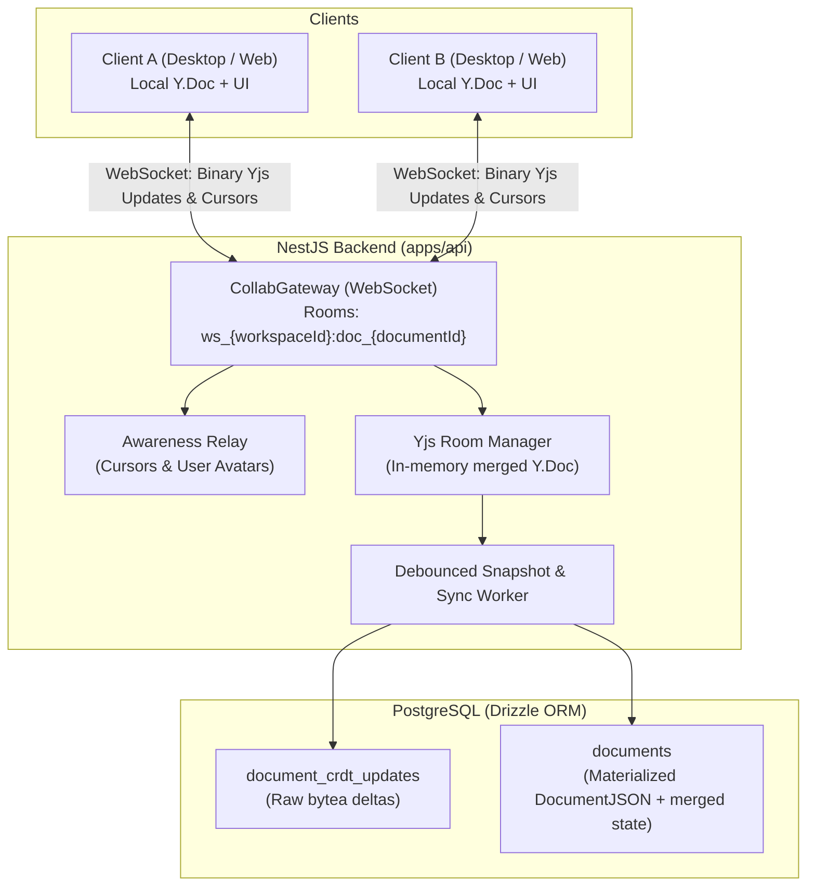

# 0002: CRDT-Powered Real-Time Collaborative Multiplayer

## Status

Accepted (Extending [ADR 0001: Local-First Mutation-Driven Sync Engine](./0001-local-first-sync-engine.md))

## Context

In ADR 0001, Yaad established a local-first mutation-driven delta sync engine for offline-capable document persistence. However, when multiple users concurrently edit the same document (or even the same block), simple snapshot overwrites result in Last-Write-Wins (LWW) clobbering, where the later edit silently overwrites earlier user contributions.

Users require:

1. **Character-level and block-level conflict-free merging** when editing concurrently.
2. **Real-time live presence** (showing collaborator cursors, selections, and user avatars).
3. **Seamless offline capability**: Users should be able to edit offline and have their changes merge deterministically when reconnecting, with zero data loss.

## Decision

We adopt **Yjs (Conflict-free Replicated Data Types - CRDT)** integrated with a **NestJS WebSocket Gateway** and **PostgreSQL Bytea Persistence** in a hybrid model:

### 1. Document Representation in CRDT (Yjs)

Each Yaad document is mapped to a `Y.Doc` with internal shared types:

- `yDoc.getMap('meta')`: Document metadata (title, icon, coverUrl).
- `yDoc.getMap('blocks')`: A key-value map from `blockId` to a `Y.Map` containing block properties, formatting, and tags.
- `yDoc.getArray('rootBlockIds')`: A `Y.Array<string>` maintaining deterministic, conflict-free block ordering.
- `yDoc.getText('block_text_<blockId>')`: Granular collaborative text for rich block editing.

### 2. Real-Time Transport: NestJS WebSocket Gateway

- Implemented using `@nestjs/websockets` with `ws` (binary WebSocket).
- Clients subscribe to rooms named `workspace:<workspaceId>:doc:<documentId>`.
- **Sync Protocol (Step 1 & Step 2)**:
  1. Upon connecting, the client sends its **State Vector** (`Y.encodeStateVector(localDoc)`).
  2. The server responds with missing updates (`Y.encodeStateAsUpdate(serverDoc, clientVector)`).
  3. The client applies the server updates and responds with any updates the server is missing.
  4. Both client and server documents are now identical.
- **Continuous Broadcast**: Subsequent keystrokes emit `Uint8Array` binary updates broadcast immediately to all peers in the room with negligible latency (< 20ms).
- **Awareness (Presence)**: Transmits collaborator cursor coordinates, block focus, user display name, and avatar color. Awareness is ephemeral (in-memory only, never persisted).

### 3. Dual-Layer Storage in PostgreSQL

To avoid the classic CRDT pitfall (inability to query or search opaque binary blobs), the server maintains two representations:

1. **CRDT State (`document_crdt_updates` / `crdt_state`)**: Stores the compact binary Yjs document state as `bytea`. This guarantees mathematically provable, conflict-free merges.
2. **Materialized JSON (`documents.content`)**: Periodically (debounced upon document idle or disconnect), the server converts the in-memory `Y.Doc` into Yaad's canonical `DocumentJSON`. This keeps full-text search, graph indexing, and web previews fast and standard.

### 4. Local Storage on Client

- **Browser (PWA / Web)**: Uses `y-indexeddb` for instant offline loading and persistence.
- **Desktop (Tauri)**: Stores binary Yjs update blobs in SQLite `document_crdt` table alongside regular cached `documents`.

## Considered Alternatives

- **Automerge**:
  - _Rejected_: While Automerge 2.0 has made impressive performance strides, Yjs has substantially broader ecosystem adoption for rich-text editors, significantly smaller binary encoding footprints, and mature awareness protocols.
- **Operational Transformation (OT) (ShareDB / Google Docs)**:
  - _Rejected_: OT requires a centralized, authoritative server to transform operations in strict linear order. It breaks down in true offline local-first applications where clients make large diverged branches of changes.
- **Pure Snapshot Overwrite with Three-Way Merge**:
  - _Rejected_: Cannot handle simultaneous typing in the same paragraph without popping up disruptive modal dialogs asking users to resolve diff conflicts manually.

## Consequences

### Positive

- **Zero Conflict Loss**: Keystrokes and block movements from multiple users merge automatically and deterministically.
- **Live Presence**: Collaborators see each other's live cursor positions and active block selections.
- **100% Offline Compatible**: Offline edits merge smoothly when reconnecting, regardless of how long the client was disconnected.
- **Dual Representation**: Binary CRDT guarantees convergence; materialized JSON guarantees fast relational queries and searchability.

### Negative / Costs

- Adds WebSocket dependencies (`@nestjs/websockets`, `ws`, `yjs`) to the backend.
- Requires in-memory room lifecycle management on the NestJS server (evicting inactive rooms from RAM when users disconnect).
- Requires debounced snapshot compaction to prevent unbounded growth of update vectors over years of edits.
